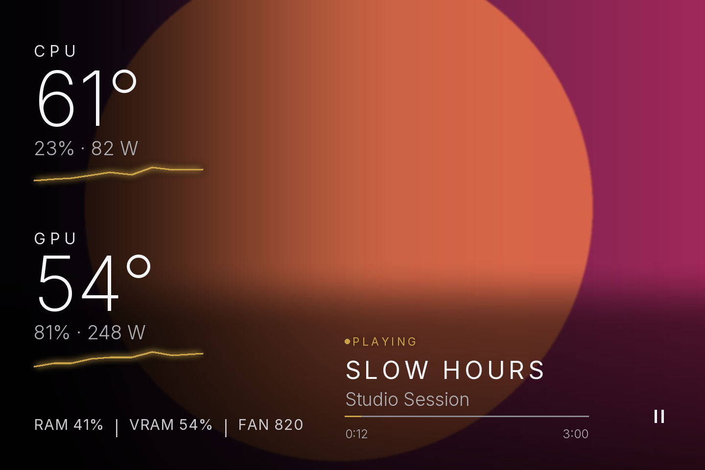

# PanelOS website

Landing page and help pages for **PanelOS**, Windows software for 3.5-inch USB PC sensor screens
(small case displays, USB ID 1A86:5722).

**Live site:** https://emirmrkaljevic.github.io/panelos-site/

## What PanelOS shows
- CPU and GPU temperature, load, watts, fans, RAM and VRAM
- Spotify now-playing with album cover (Pro)
- Six themes: Classic, Signature, Nature Flow, Noir Editorial, Gallery, Chronograph
- Landscape or portrait, custom accent color, starts with Windows from the tray

**Lite** is free (Classic theme, all sensors). **Pro** is €14.99 one-time: all themes, Spotify, 2 PCs, all 1.x updates.

## Help
[Setup](https://emirmrkaljevic.github.io/panelos-site/help/setup.html) ·
[Themes](https://emirmrkaljevic.github.io/panelos-site/help/themes.html) ·
[Spotify](https://emirmrkaljevic.github.io/panelos-site/help/spotify.html) ·
[Screen not connecting](https://emirmrkaljevic.github.io/panelos-site/help/device-not-connected.html) ·
[CPU temperature shows 0](https://emirmrkaljevic.github.io/panelos-site/help/cpu-temperature-zero.html) ·
[Compatible screens](https://emirmrkaljevic.github.io/panelos-site/help/compatible-screens.html)
